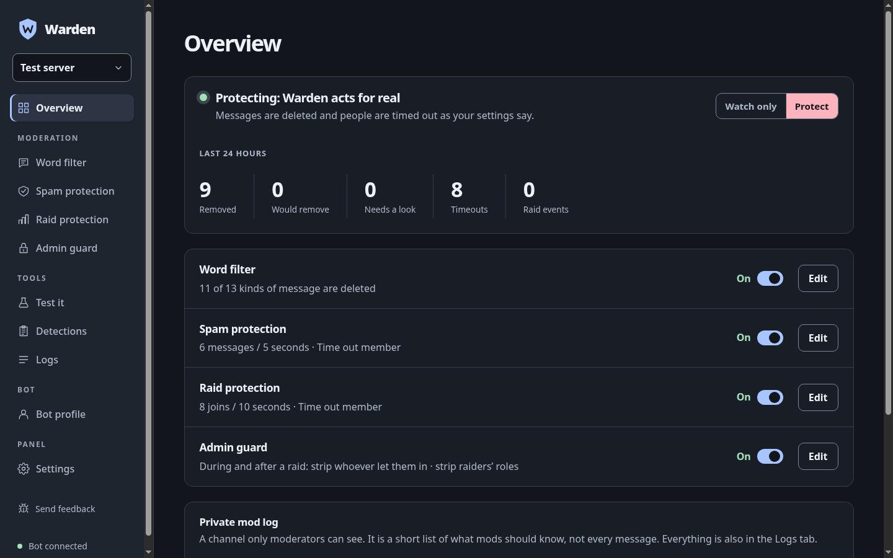
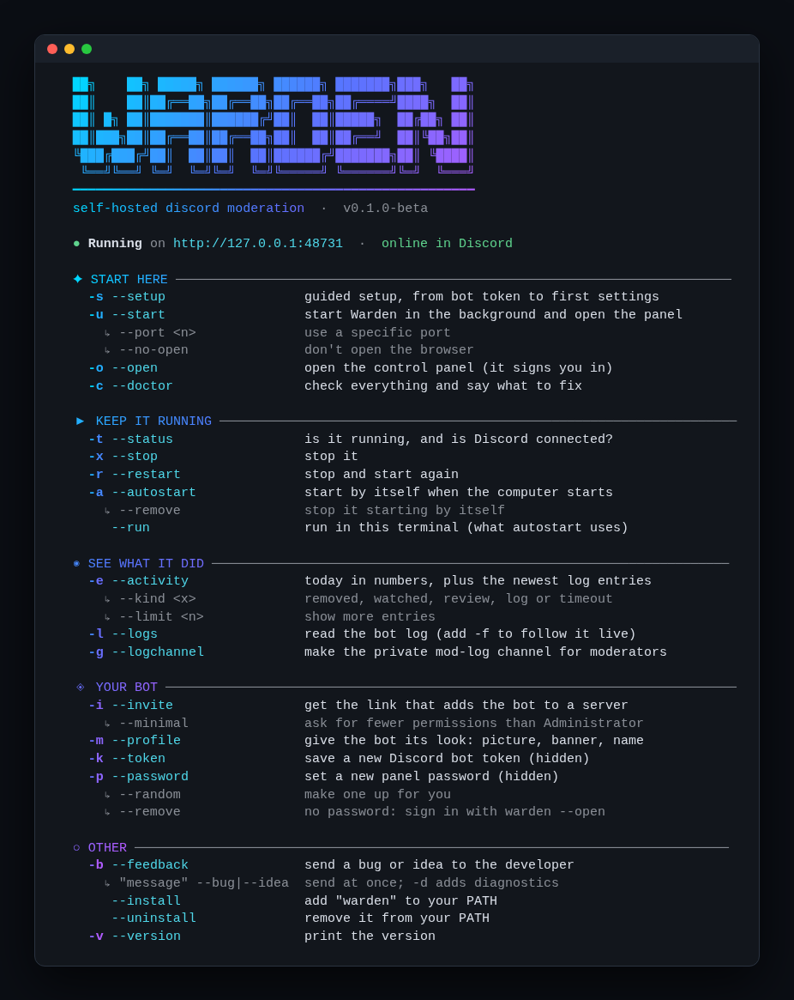
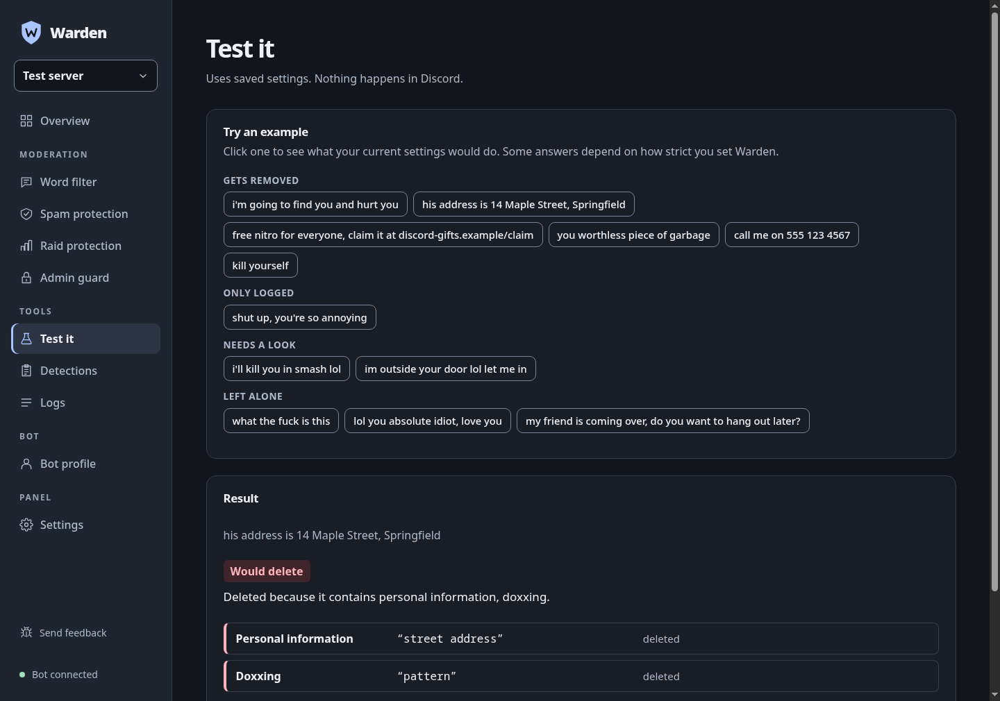
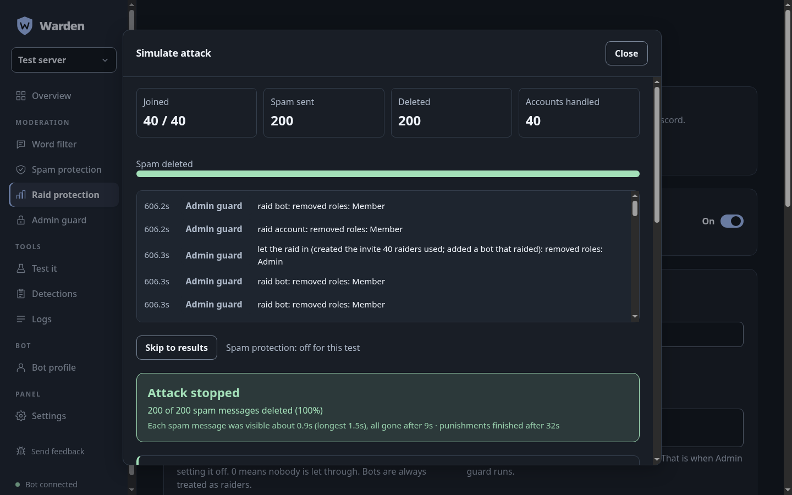

# Warden

> **Beta (v0.1.0-beta).** It works and is tested, but it is young: run it in Shadow mode first, expect rough edges, and please [report what you find](https://github.com/mttcn83/warden/issues).

A self-hosted Discord moderation bot you run yourself: word filter, spam protection, raid protection and an admin guard, all **off until you turn them on**. A guided setup gets you running in minutes, a control panel on your own computer tunes everything, and nothing about your server ever leaves your machine.

- **Yours.** You create the bot, you hold the token, you host it. No account, no cloud, no telemetry. (The optional feedback button only sends what you approve.)
- **Plain rules, no AI model.** Every decision comes from readable rules you can edit, so you can see why a message was removed. Runs on a normal PC, a Raspberry Pi or a small VPS; no GPU, no downloads.
- **Safe to try.** Shadow mode records what it *would* do without touching anything, and the "Simulate attack" fire drill shows raid protection working on a virtual server.

<p align="center"></p>

**Requirements:** [Node.js](https://nodejs.org) 22 or newer (setup checks this and tells you what to install) and a Discord server where you can add a bot.

## Features
- **Word filter (plain rules, no AI model)**: every message is checked against clear, editable rules, and each kind of message has its own setting (Allow / Log only / Delete):
  - *Personal information* (phone numbers, emails, IP addresses, street addresses, card and social security numbers), *doxxing*, *threats and self-harm*,
  - *slurs*, *insults aimed at someone*, *swearing aimed at someone* (the filter works out whether a message is aimed at a person: a "you" nearby, a ping or reply, a command like "uninstall"),
  - *general swearing* and *sexual content* (allowed by default), and your own words, patterns and allow-list.
  - **Exceptions**: different rules for certain channels or roles (for example, allow swearing in #memes, or only log insults for your moderators). Each exception picks channels, roles and kinds of message, and whether to allow, log or delete. The last matching exception wins. There is no "looks friendly" guessing: the rules you set decide.
  - **Edits are checked too**: a harmless message edited into something bad is judged like a new one (and a message edited into a wall of emoji or shouting, by Spam protection).
  - **Repeat offenders**: every deletion is a strike (serious ones count more); enough strikes in a window means a timeout.
  - Under the hood: [obscenity](https://github.com/jo3-l/obscenity) (MIT, resists "fuuuck"/"fvck"-style evasion), the `bad-words` list (MIT), and editable lists in `lists/`.
- **Spam protection** also catches shouting (too many capitals), emoji walls and zalgo text, on top of message floods, repeats and mention spam.
- **Tested on 2,300+ human-written messages** (`bench/`): banter, games, quotes, news, supportive text and code are left alone; insults, threats, hate, scams and leaks in about 25 languages are caught, including disguised spellings. See `bench/README.md` for the method and honest numbers.
- **Masked and disguised words**: `f*ck`, `sh#t`, lookalike letters, spaced-out letters, stretched letters, plus an allowlist so names like Scunthorpe or "shiitake" are never flagged.
- **Adaptive learning (off by default, no human feedback needed)**: the filter notices words that keep showing up in abusive messages from several different people and starts flagging them too (log-only unless you change it). It stores word counts only, never messages, and you can press Forget on anything it picked up by mistake. It also sees through lookalike letters (a Cyrillic "а" in place of "a") and typos of strong insults.
- **Spam protection**: message rate, repeats (also near-identical ones where only a number or link changes), mention spam. When someone is caught, **everything they sent in the last two minutes is deleted, in every channel**. Members who just joined get half the limits, because spam bots post right after joining.
- **Raid protection**: catches both a burst of joins and a **slow drip** of look-alike new accounts (fresh, no picture, similar names, created together; one odd trait is never enough). Each account counts once, and long-standing accounts with a picture count for only a quarter and are let through, so someone like Kevin leaving and rejoining quickly never sets it off. Raid accounts are timed out, kicked or banned (**admins and bots are not spared**: only the server owner, this bot and your trusted admins are never touched), **every message they send is deleted however many there are**, what they sent before detection is purged and swept from channel history, and an account that posts the same text as the raiders is caught even if its profile looks normal. Invites are paused while the raid lasts.
- **Admin guard**: its main job is **whoever let the raiders in**. It names them and says why (created the invite that several raiders used, added a raid bot, gave a raider a role, gave a role dangerous permissions), and removes their dangerous roles (Administrator, Manage Server/Roles/Channels, Kick, Ban, Manage Webhooks), **while the raid is still going** once the evidence is clear. After the raid it also strips the raid accounts' own roles. The owner, this bot, other bots and your trusted admins are never touched. Needs View Audit Log and Manage Roles, and the bot's role must be above the roles it changes.
- **Simulate attack**: a fire drill on the Raid protection page. 20 to 200 fake bots, some with the Admin role, join a *virtual* server and spam "this server is ours" while an owner, a trusted mod, a careless admin and normal members are also there. It runs the real raid and guard code on a virtual clock, with Spam protection off so only Raid protection and Admin guard are tested, and ends with a pass/fail checklist (detection, every message deleted, owner and trusted admin untouched, roles stripped, who let them in). Burst, waves and slow-drip styles are included, and Kevin (an old member who rejoins five times in a few seconds) must come out untouched. It tests the decisions and timing; real alt accounts are still the way to test Discord permissions and role order.
- **How strict?** Relaxed, Standard or Strict in one click (setup asks too). *Rudeness* ("nobody asked", "try-hard", "most useless admin ever") is its own rule, logged by default, and a **swearing level** (all, medium and strong, strong only) decides which swear words count. Every rule can still be changed one by one.
- **Needs a look**: when a message could be banter or a real problem ("i'll kill you in smash lol", "im outside your door"), Warden deletes nothing and punishes nobody. It records it and tells your moderators in the mod log (switchable: off, log, notify).
- **Private mod log**: `warden --logchannel`, the setup wizard or one panel button creates a channel hidden from everyone except moderator roles and the bot. Quick and Guided setup explain how to give moderators access and how to check it is private. It gets a short list of what mods should know: removals (personal info is never repeated), timeouts, raids, and messages that need a look. The panel warns if the channel can be read by everyone.
- **Logs tab and `warden --activity`**: every action the bot took (filter, spam, raid, guard), searchable, filterable by kind and downloadable. The Overview shows the last 24 hours and has a one-click **Watch only / Protect** switch.
- **Shadow mode**: records what the filter, Raid protection and Admin guard *would* do without acting, so you can check first. Raid protection and Admin guard start in shadow mode.
- **Detection log**: a read-only list of what the filter flagged or wants a moderator to look at.
- **Test mode**: applies rules to owner/admins for 30 minutes so you can try it on your own account.

## A look around

**The command line** is built to be readable: `warden -h` shows what is running and every command in plain words.

<p align="center"></p>

**Test it** shows what your current settings would do with any message, with one-click examples, and never touches Discord.

<p align="center"></p>

**Simulate attack** runs a fake raid (bursts, waves or a slow drip) against your real settings on a virtual server and ends with a pass/fail checklist, including that a long-standing member who rejoins is left alone.

<p align="center"></p>

## Quick start

```bash
git clone https://github.com/mttcn83/warden.git && cd warden
node bin/warden.js --setup        # or: npm run setup
```

`warden --setup` is a wizard for normal users. It starts by asking how you want to set up:

| Mode | For whom |
|---|---|
| **Quick** (about 2 minutes) | People who have done this before. Almost no explanations: you paste the bot token and choose how to sign in, everything else is automatic with safe choices (Careful mode). |
| **Guided** (about 10 minutes) | **Beginners.** A checklist first, a short glossary (bot, token, server), the Discord steps split into four small parts with a pause after each, a plain explanation before every decision, and a "what to do now" tour at the end. |
| **Full walkthrough** | People who want control. Every feature explained and you choose each one: word filter strictness, swearing, spam, raid protection, admin guard, a mod-log channel, learning. |
| **Skip to start** | Already set up. Just starts Warden. |

Along the way it checks your computer (and installs what is missing), opens the Developer Portal for you, checks your token with Discord, waits by itself until the two privileged intents are switched on, builds the invite link and waits until the bot has joined your server, lets you choose how to sign in to the panel (no password, your own, or a generated one), applies your choices, and offers to start Warden automatically whenever the computer starts.

It also shows the warnings that matter: Warden only protects while it is running, so turning off or sleeping the computer stops it (use an always-on machine like a Raspberry Pi, home server or small VPS for 24/7 protection), keep the bot token secret, and put the bot's role near the top of the role list.

You can stop with Ctrl+C and run it again at any time. It keeps what is already set up.

## Command line

After setup, add the command to your PATH once with `warden --install` (the wizard offers to). Every command works as `warden --name`, `warden name`, or, for the common ones, a short single-dash version:

| Short | Long | Short | Long | Short | Long |
|---|---|---|---|---|---|
| `-s` | `--setup` | `-u` | `--start` | `-k` | `--token` |
| `-c` | `--doctor` | `-x` | `--stop` | `-p` | `--password` |
| `-t` | `--status` | `-r` | `--restart` | `-i` | `--invite` |
| `-o` | `--open` | `-l` | `--logs` (`-f` follows) | `-m` | `--profile` |
| `-a` | `--autostart` | `-b` | `--feedback` (`-d` adds diagnostics) | `-g` | `--logchannel` |
| `-e` | `--activity` | `-v` / `-h` | `--version` / `--help` | | |

| Command | What it does |
|---|---|
| `warden --setup` (`-s`) | guided setup (see above) |
| `warden --doctor` | checks Node, packages, token, intents, servers, password and PATH, and says what to fix |
| `warden --start` | starts in the background on a free port and opens the panel, already signed in (`--port <n>`, `--no-open`) |
| `warden --open` | opens the panel again, signed in |
| `warden --status` | is it running, on which port, and is Discord connected |
| `warden --stop` / `warden --restart` | stop it / stop and start again |
| `warden --autostart` | starts Warden by itself when the computer starts, and restarts it if it crashes (Linux systemd and macOS; `--remove` to undo). It still needs the computer to be on |
| `warden --run` | runs Warden in the terminal instead of the background (this is what autostart uses) |
| `warden --logs` | shows the log (`-f` to follow) |
| `warden --token` | saves a new Discord bot token (hidden input, checked with Discord) |
| `warden --password` | sets a new panel password (`--random` generates one, `--remove` uses no password and signs you in only through `warden --open`) |
| `warden --activity` | what Warden did lately: counts for the last 24 hours (removed, would remove, needs a look, timeouts, raid events) and the newest log entries. `--kind removed\|watched\|review\|log\|timeout` filters, `--limit 50` shows more. The panel's **Logs** tab shows the same, with search and a JSON download |
| `warden --logchannel` | creates the private mod-log channel in every server that does not have one: hidden from everyone, visible only to moderator roles and the bot. Warden posts what it removed, who was timed out, raids and messages that need a look. Needs the Administrator invite (or Manage Channels). The setup wizard offers it too; the panel has a button |
| `warden --profile` | gives the bot the Warden look: the shield "W" picture, a plain blue banner, a short description, the username Warden (if Discord rejects it, a close variant) and the nickname Warden in every server. Asks first, and never replaces an existing picture without saying so. The setup wizard offers it too |
| `warden --invite` | prints and opens the link that adds the bot to a server (Administrator is recommended; `--minimal` asks only for the permissions Warden uses) |
| `warden --feedback` | sends a bug report or idea to the developer. It asks a few questions, shows exactly what will be sent (secrets, IDs, emails and IPs removed first) and only sends after you say yes. Quick form: `warden --feedback "it froze" --bug -d` (`-d` adds diagnostics, `--contact <how to reach you>`) |
| `warden --install` / `warden --uninstall` | adds / removes `warden` on your PATH (`~/.local/bin`) |
| `warden --version` | prints the version |

The CLI uses colors and small animations when it runs in a real terminal. It falls back to plain text when the output is piped, and you can turn the effects off with `NO_COLOR=1` (no colors) or `WARDEN_NO_ANIMATION=1` (no animation).

`--start` runs the bot in the background. The panel opens through a one-time link, so no password is needed (set one with `warden --password` if you also want it).

## Send feedback (the bug button)

The control panel has a 🐛 **Send feedback** button (bottom of the sidebar) and the CLI has `warden --feedback`. Both show the exact message first, remove tokens, passwords, IDs, emails and IP addresses, never ping anyone, and allow one report per minute. Diagnostics (version, system, last log lines) are optional and off by default.

**For the maintainer:** this public copy ships without a feedback address, so the button saves the note to a file on your own computer. To receive reports, copy [`feedback.config.example.json`](feedback.config.example.json) to `feedback.config.json` (it is git-ignored) and paste a Discord webhook URL (channel settings → Integrations → Webhooks → New Webhook → Copy Webhook URL) or an `https://ntfy.sh/<your-topic>` URL, or set `WARDEN_FEEDBACK_URL`. Reports are small, redacted and rate limited.

## Run manually
1. Create a bot at https://discord.com/developers/applications (**New Application** → name it → tick the terms box → **Create**), open **Bot**, reset and copy the token, switch on the **Server Members** and **Message Content** intents and press Save.
2. `cp .env.example .env` and set `DISCORD_TOKEN` (and optionally `GUI_PASSWORD`).
3. `npm install && npm run dev`
4. Open http://127.0.0.1:48731 and log in with your `GUI_PASSWORD`.

Add the bot to your server with the link from `warden --invite`. Administrator is the easy choice; `warden --invite --minimal` asks only for the permissions Warden uses.

## Docker
For an always-on server you can use Docker instead of the wizard:

```bash
cp .env.example .env     # set DISCORD_TOKEN and GUI_PASSWORD (the password is required in Docker)
docker compose up -d
```

The panel is published to `127.0.0.1:48731` on that machine only, and settings live in a Docker volume. To reach it from another computer use an SSH tunnel (`ssh -L 48731:127.0.0.1:48731 you@server`); if you put it behind a reverse proxy, add its hostname to `GUI_ALLOWED_HOSTS` and keep it authenticated.

## Security and privacy
- The panel listens on `127.0.0.1` only, checks the `Host` and `Origin` of every request, sets a strict content policy, and signs you in with a one-time link or your password. Sessions expire after 12 idle hours and password guesses are rate limited.
- The bot token lives in `.env` (mode 600) and is never sent to the panel or anywhere except Discord. Nothing is uploaded: message text is only kept in your local database (flagged messages for 7 days, the audit log for 90).
- The mod-log channel Warden creates is hidden from everyone except moderator roles; the panel warns if a log channel is readable by everyone. Removed messages that contain personal information are never repeated in it.
- Found a vulnerability? See [SECURITY.md](SECURITY.md).

## Hardware
| Part | Download | RAM | Speed |
|---|---|---|---|
| Rules (word filter, spam, raid, guard) | none | tiny | ~0.5 ms per message |

## Measuring accuracy
`bench/` holds **2,886 hand-written test messages** (banter, games, quotes, news, friends chatting, real insults in many styles, threats, scams, doxxing, about 25 languages). On them the default rules remove what a moderator would remove and leave the rest alone. Honest caveat: the rules were tuned against these sets, so on your server expect more misses and the occasional wrong call, especially with abstract or sarcastic insults. Start with **Shadow mode** to see what the filter would do on your own chat before letting it delete anything. See `bench/README.md` for the method.

## Contributing
Bug reports, ideas and pull requests are welcome, see [CONTRIBUTING.md](CONTRIBUTING.md). Release notes are in [CHANGELOG.md](CHANGELOG.md).

## License
[MIT](LICENSE). All bundled third-party parts are permissively licensed (MIT / Apache-2.0), see [THIRD_PARTY_NOTICES.md](THIRD_PARTY_NOTICES.md).
